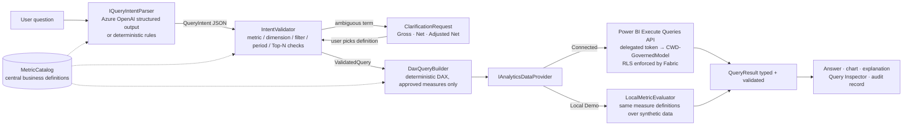

# Architecture

**Northstar Distribution – Chat with Your Data** demonstrates why "LLM → SQL → database" fails in the enterprise and
what a governed alternative looks like on Microsoft Fabric with .NET 10.

## The one rule

> The LLM interprets. It never executes.

Azure OpenAI returns a **structured query intent** (strict JSON schema). Everything after that – catalog lookup,
ambiguity detection, validation, DAX generation, execution with the user's delegated identity, result typing – is
deterministic server-side C#. The model cannot name a table, a column, a measure or a user; it can only pick from the
ids the application publishes.

## Projects

| Project | Responsibility |
|---|---|
| `Northstar.Domain` | Metric catalog, `QueryIntent`/`Period`/`ValidatedQuery`, `IntentValidator`, `DaxQueryBuilder`, synthetic data generator, `LocalMetricEvaluator`, personas |
| `Northstar.Application` | Ports (`IQueryIntentParser`, `IAnalyticsDataProvider`, `IUserContextAccessor`, `IQueryAuditStore`), `QueryPipeline`, `PrototypeQueryService`, `ReconciliationService`, `SystemHealthService` |
| `Northstar.Infrastructure` | `AzureOpenAiQueryIntentParser`, `DeterministicDemoQueryIntentParser`, `FabricExecuteQueriesProvider`, `LocalDemoDataProvider`, Entra/Power BI token plumbing, DI (`AddNorthstarCore`, `AddNorthstarExecutionMode`) |
| `Northstar.Web` | Blazor Web App (Interactive Server), minimal API (`/api/*`, OpenAPI), Entra sign-in, OpenTelemetry |
| `Northstar.Fabric.Tool` | Idempotent provisioning: warehouse, SQL schema `cwd`, seed, Excel ingestion, TMDL deployment, permissions, validation |
| `Northstar.Tests` | xUnit: ambiguity, validation, DAX, periods, reconciliation, permissions, Fabric error handling (mocked HTTP), API consistency |

## Pipeline (production mode)

1. Question → `IQueryIntentParser.ParseAsync` → `QueryIntent` (metric id *or* ambiguous term, dimensions, period(s), filters, Top-N, flags).
2. `IntentValidator.Validate` against `MetricCatalog`: unknown/unapproved metric → **Rejected**; ambiguous term → **ClarificationRequired** with the candidate definitions; unknown dimension/filter value, invalid year, Top-N > 25, grain mismatch (e.g. Net Revenue by Product Category) → **Rejected**/capped.
3. Clarification keeps the pending intent in `ConversationContext`; the chosen metric is swapped in – the user does not retype.
4. `DaxQueryBuilder.Build` emits `DEFINE VAR … EVALUATE SUMMARIZECOLUMNS(...)`/`ROW(...)` using only catalog tables/columns/measures; dates are `DATE(y,m,d)` literals, filter members are validated catalog values wrapped in `TREATAS`.
5. `IAnalyticsDataProvider.ExecuteAsync` with a 30 s timeout. Connected: `POST /groups/{ws}/datasets/{id}/executeQueries` with the signed-in user's token (`Dataset.Read.All`); HTTP 200 bodies are still checked for `results[0].error`; 429/401/403/404 become typed `DataProviderException`s with user-safe messages.
6. `ResultExplanation` (definition, formula, measure, owner, period, filters, data origin, security context) travels with every answer; `QueryExecutionRecord` (intent, validation, DAX, timings, correlation id) feeds the Query Inspector and `/api/query/{id}/explanation`.

## Prototype mode (educational)

`PrototypeQueryService` + `IPrototypeDataSource`: keyword matching, one implicit revenue definition, no catalog, no
clarification, no explanation, no RLS. It is an **intentionally simplified educational example**: in both modes it reads
the same reproducible synthetic order table directly ("amount − discount, incl. cancelled" – no returns, no finance
adjustments), so prototype and production can be compared against the same underlying business data and differ only
where the governance rules explain the difference. It never executes model-generated SQL – the "generated query" is
displayed and blocked.

## Fabric footprint

| Item | Created by | Used as |
|---|---|---|
| Schema `cwd` in your warehouse (star schema, 9 tables) | `Northstar.Fabric.Tool create-schema/seed` | Physical data for the governed model; nothing outside `cwd` is touched |
| Semantic model `CWD-GovernedModel` (Direct Lake on `cwd`) | `Northstar.Fabric.Tool deploy-model` | Production-mode model: 9 described measures, date table, RLS role `Regional Reader` driven by `cwd.RegionAccess` |
| Warehouse `CWD-Warehouse` (optional) | `Northstar.Fabric.Tool create-warehouse` | Host warehouse if you do not want to reuse an existing one |

## Modes

| | Local Demo | Connected |
|---|---|---|
| Parser | Deterministic rules | Azure OpenAI (gpt-4.1-mini, strict JSON schema) or Deterministic |
| Data | In-memory synthetic dataset (seed 20260325) | Fabric semantic model via Execute Queries |
| Identity | Simulated personas (clearly labelled) | Entra ID sign-in, delegated Power BI token |
| Authorization | Enforced in `LocalMetricEvaluator` from persona regions | Enforced by Fabric RLS; app never filters by a client-supplied region |

Both modes share the catalog, validator, DAX builder, pipeline, API and UI.

## Observability

JSON console logging with scopes (correlation id, user), OpenTelemetry tracing for ASP.NET Core and outgoing HTTP, in-memory audit store, System Health screen with live checks (dataset load / Fabric metadata call / Azure OpenAI ping), last successful query, recent errors, average duration.
